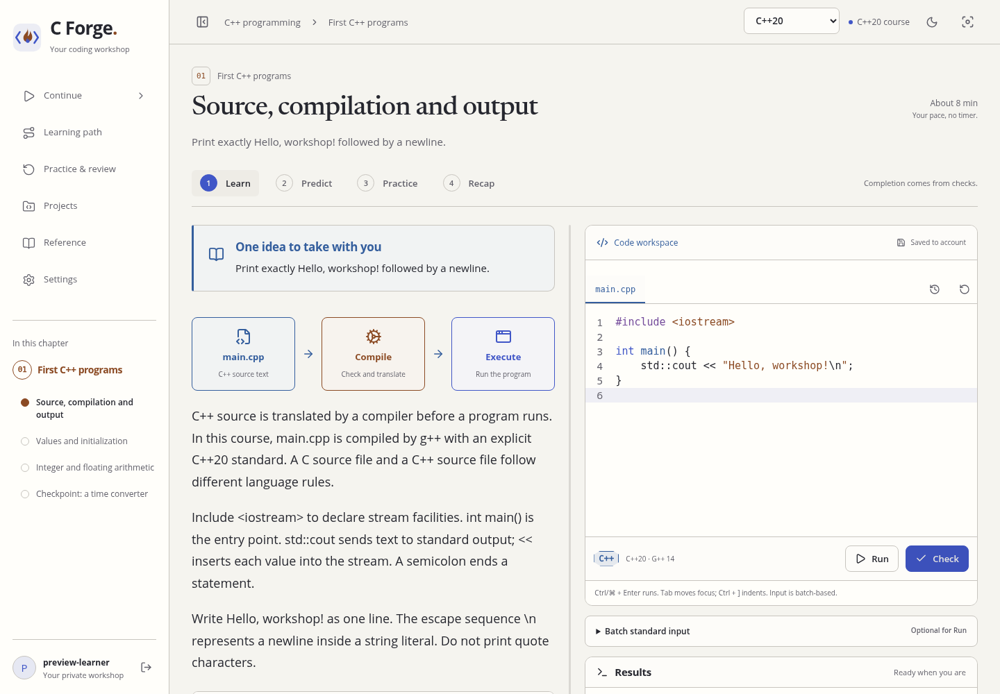
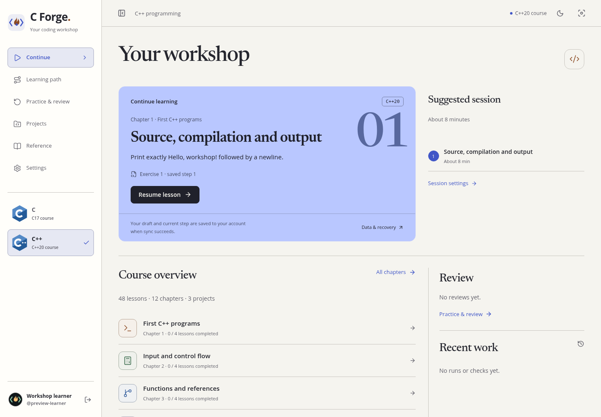
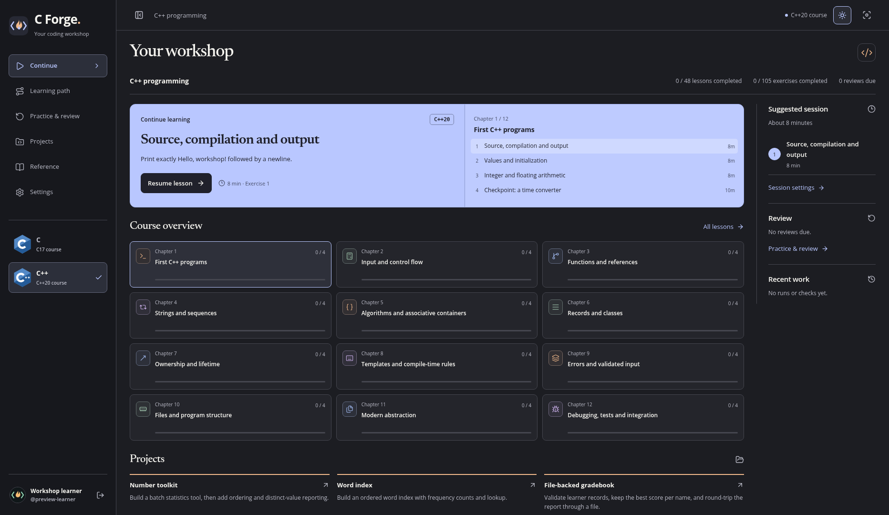
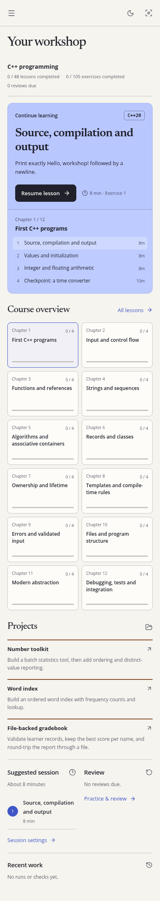
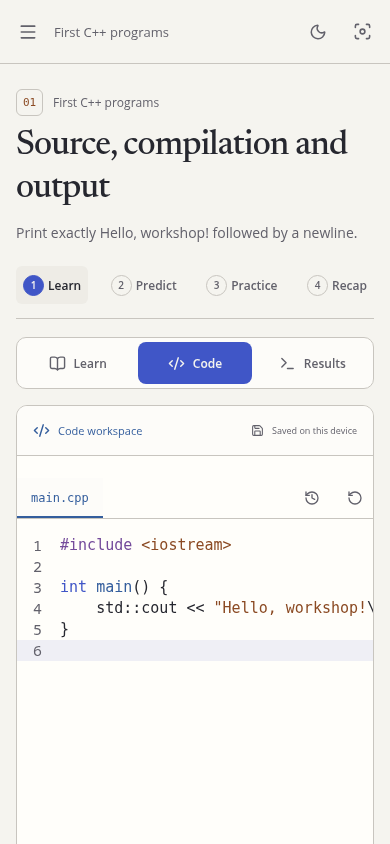
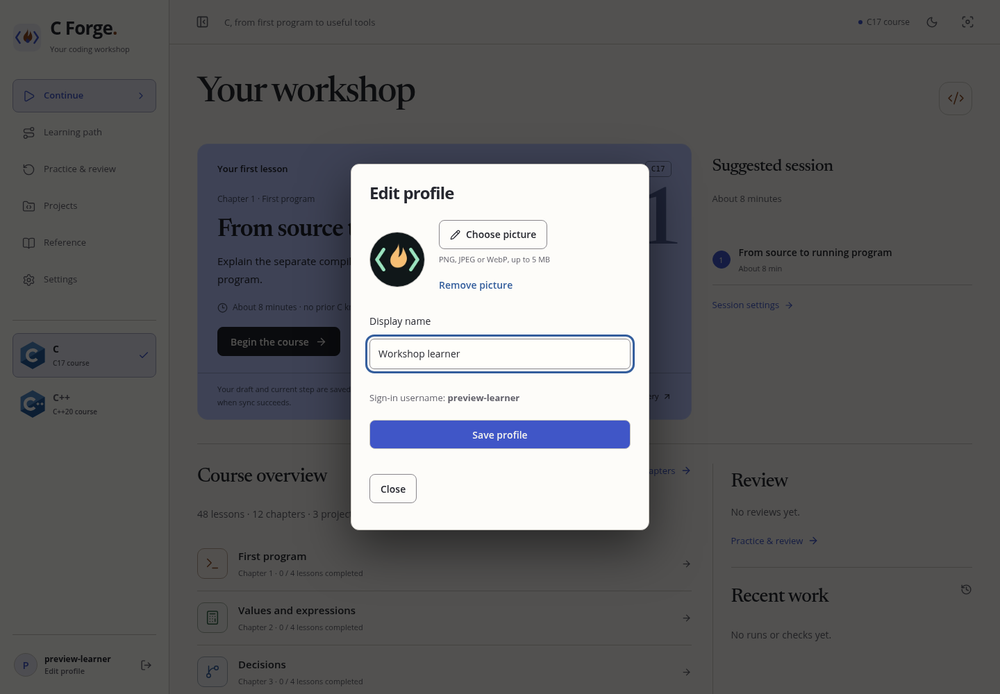

  
  <h1>C Forge</h1>
  
A coding workshop for learning C and modern C++.

  
C17 and C++20 courses with an editor, checks and saved progress.

  
<a href="https://c-forge-workshop.tahuna-2388.chatgpt.site">Open the workshop</a> · <a href="https://c-forge.51.170.138.252.sslip.io:8445/forge/">Direct server</a> · <a href="docs/CURRICULUM.md">C course</a> · <a href="docs/CPP-COURSE.md">C++ course</a>

## Two courses, one workshop

| | C | C++ |
| --- | --- | --- |
| Language baseline | C17 | C++20 |
| Ordered chapters | 12 | 12 |
| Lessons | 48 | 48 |
| Exercises | 105 | 105 |
| Chapter checkpoints | 12 | 12 |
| Guided projects | 3 | 3 |
| Reference entries | 39 | 48 |

Start either course without prior programming knowledge. Choose C or C++ in the
sidebar; each keeps its own drafts, progress, reviews and resume position. The
course choice and reading preferences are saved to your account.

**C** covers first programs, control flow, functions, arrays, strings, pointers,
input validation, records, allocation, files and debugging.

**C++** covers first programs, references, standard containers, algorithms,
classes, RAII, smart pointers, templates, concepts, errors, files, multiple source
files, lambdas, range views, moves, polymorphism and debugging.

Both paths include coding tasks and explicitly labeled conceptual assessments.
C and C++ have separate language rules, file types and compiler settings.

## Inside the workshop

- **A real editor.** Locally bundled CodeMirror, multiple source files, batch input,
  compiler diagnostics and keyboard shortcuts.
- **Run and Check.** Run explores your program. Check evaluates the exercise's
  server-owned contract. Running a program does not award proficiency.
- **Work that survives a break.** Account saves, revision checks, draft history,
  conflict recovery and a device recovery buffer.
- **Practice with context.** Predictions, staged hints, explained solutions,
  chapter checkpoints, guided projects and scheduled review.
- **A comfortable reading setup.** Light and dark themes, adjustable text sizes,
  line spacing, reduced motion and a focused lesson view.
- **Your own account.** Separate learner data, portable exports and import previews.
  Click your profile to set a display name and picture. No email or social account
  is required.

More screenshots

The hosted workshop and direct server use the same learner accounts and saved
work. Sign in separately on each hostname. The direct address opens the VPS
application without going through the Sites host.

## Built with

React, TypeScript, Vite, Fastify, SQLite, TanStack Query and CodeMirror.
A separate unprivileged worker compiles C17 and C++20 with GCC 14.2.0 inside
rootless Podman containers. Fonts, icons, editor assets and lessons are bundled
locally.

## Documentation

| Documentation | |
| --- | --- |
| [Architecture](docs/ARCHITECTURE.md) | Accounts, saving and execution boundaries |
| [C++ course](docs/CPP-COURSE.md) | Chapter map and assessment coverage |
| [Runner](docs/RUNNER.md) | Isolation, toolchain and resource limits |
| [Verification](docs/VERIFICATION.md) | Checks, evidence and known limits |
